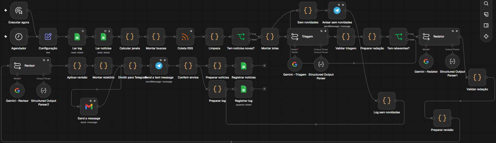
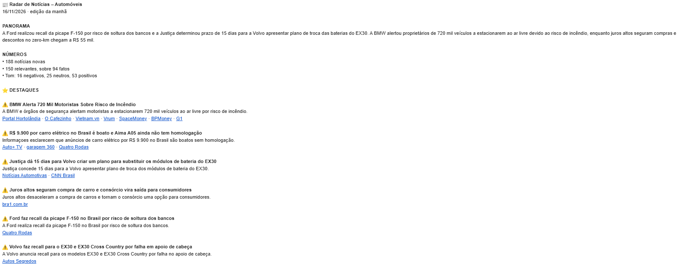
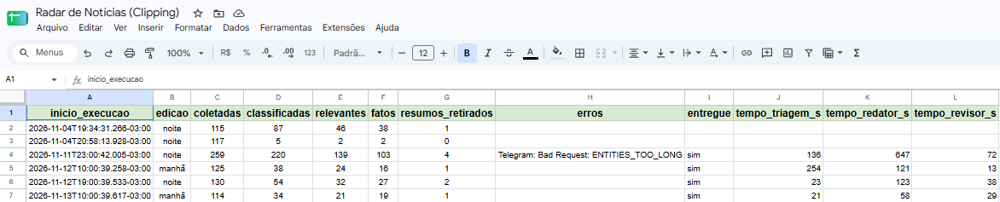

# Radar de Notícias com IA

Clipping automático de notícias com **n8n** e **agentes de IA**. Duas vezes por dia, o fluxo busca notícias sobre um tema, filtra, classifica e resume, e entrega um relatório no Telegram e no e-mail.

<p align="center">
  
</p>

## O problema

Na assessoria de imprensa, o clipping (procurar, ler e organizar as notícias sobre um cliente e conferir se elas trazem as mensagens-chave dele) é feito à mão e leva de 30 minutos a 1 hora por dia. Além do tempo, sempre existe o risco de deixar alguma notícia passar. Este projeto automatiza esse trabalho.

## Resultado

- O relatório chega sozinho às 10h e às 19h, já com as notícias classificadas por tom, aderência e mensagens-chave.
- Nas primeiras execuções automáticas, cada edição levou **de 2 a 7 minutos**, sem ninguém mexer no computador. O trabalho de quem recebe passa a ser ler o relatório.
- A mesma notícia publicada em vários veículos vira um item só, com todos os veículos listados, e nada que já foi enviado se repete.
- Cada execução fica registrada numa planilha, com os números da rodada, os erros e o tempo de cada agente.

| Execução automática | Coletadas | Novas | Relevantes | Fatos | Tempo total |
|---|---|---|---|---|---|
| 12/11, 10h | 125 | 38 | 24 | 16 | 6 min 50 s |
| 12/11, 19h | 130 | 54 | 32 | 27 | 3 min 19 s |
| 13/11, 10h | 114 | 34 | 21 | 19 | 2 min 4 s |

## Como funciona

<p align="center">
  
</p>

```
Agendador (10h e 19h) ─┐
                       ├→ Configuração → Ler log → Ler notícias → Calcular janela
Executar agora ────────┘
   → Montar buscas → Coleta RSS → Limpeza → Tem notícias novas?
   → Montar lotes → Triagem (Gemini) → Validar triagem
   → Preparar redação → Tem relevantes?
   → Redator (Gemini) → Validar redação
   → Preparar revisão → Revisor (Gemini) → Aplicar revisão → Montar relatório
   → Gmail → Dividir para Telegram → Telegram → Conferir envios
   ├→ Preparar notícias → Registrar notícias (Sheets)
   └→ Preparar log → Registrar log (Sheets)

Sem notícia nova ou sem nenhuma relevante:
   → Sem novidades → Aviso no Telegram → Registrar log (Sheets)

Erro em uma execução automática (workflow separado):
   Error Trigger → Montar alerta → Telegram
```

Três agentes de IA fazem o trabalho de leitura e escrita. Todo o resto (datas, contagens, links, regras de agrupamento e a retirada do que a IA errou) é feito por código, para a IA não ter como inventar esses dados.

- **Disparo:** o fluxo roda às 10h e às 19h, ou na hora em que eu clicar em **Executar agora**. O n8n roda no meu computador e abre sozinho quando o Windows inicia, pelo script [`scripts/iniciar-n8n.bat`](scripts/iniciar-n8n.bat) colocado na pasta Inicializar. O botão cobre os horários em que o computador estiver desligado.
- **Configuração:** um único nó onde quem usa define o `tema`, o `foco_do_cliente`, os `termos_de_busca`, as `mensagens_chave` e os destinos do relatório. O repositório traz um exemplo fictício: uma rede de concessionárias de carros novos.
- **Janela de busca (sem IA):** o fluxo lê na planilha quando rodou pela última vez e busca desde esse momento, com 1 hora de folga. Se o computador ficar desligado por dias, nada se perde: a busca volta até 7 dias. Na primeira execução, sem histórico, usa 24 horas.
- **Coleta:** uma busca no Google News RSS para cada termo.
- **Limpeza (sem IA):** junta os resultados, remove repetidas, mantém só o que está dentro da janela e tira o que já foi enviado. A mesma matéria em veículos diferentes conta como duas inserções, como no clipping de assessoria.
- **Triagem (IA):** as notícias vão em lotes de 10 para o Gemini 3.5 Flash Lite, 3 lotes por vez, com 15 segundos de pausa entre os grupos para respeitar o limite de pedidos por minuto do plano gratuito. Para cada notícia, ele devolve:
  - **relevância:** se o tema é o assunto principal (ocorrências policiais, sorteios e anúncios ficam de fora)
  - **tom:** positivo, neutro ou negativo para o negócio do cliente
  - **aderência:** alta, média ou baixa em relação aos interesses do cliente
  - **mensagens-chave** encontradas, um resumo curto e o motivo da decisão
- **Validação (sem IA):** a resposta precisa seguir um JSON Schema. Um nó de código confere se todas as notícias voltaram classificadas, corrige valores fora do padrão e descarta mensagens-chave que a IA tenha inventado.
- **Redator (IA):** agrupa as notícias que tratam do mesmo fato, mesmo com títulos diferentes, e escreve um panorama do período e um resumo de cada grupo, usando só o que está nos títulos.
- **Regras do grupo (sem IA):** um grupo entra no relatório se pelo menos uma cópia foi relevante, para nenhuma inserção do assunto ficar de fora. Tom e aderência saem da maioria das cópias relevantes. Título, veículos, links e contagens vêm dos dados, então a IA não tem como inventá-los.
- **Revisor (IA):** confere cada texto contra os títulos e aponta o que não está neles. Ele não reescreve nada.
- **Aplicar revisão (sem IA):** o código retira o que foi apontado. O resumo reprovado é apagado, e a notícia fica só com título e veículos. No panorama, sai só a frase com problema. Se o Revisor falhar, o relatório sai sem textos da IA.
- **Relatório (sem IA):** panorama, números, destaques, setor, outras notícias e mensagens-chave. Em cada seção, as notícias negativas vêm primeiro.
- **Entrega:** o relatório vai para o Gmail, em uma mensagem só, e para o Telegram, dividido em mensagens que respeitam três limites: caracteres, formatações e o tamanho somado dos endereços dos links. A edição é **manhã** antes das 14h e **noite** a partir daí.
- **Falha no envio (sem IA):** se o Telegram ou o Gmail falhar, o fluxo não para. O nó **Conferir envios** verifica cada canal. Se pelo menos um entregou, as notícias vão para a planilha. Se nenhum entregou, elas não vão, e essa execução não conta para a janela de busca: a próxima busca as notícias de novo. Nos dois casos, o erro fica registrado no log.
- **Sem novidades:** se não houver notícia nova, ou se nenhuma for relevante, os agentes não são chamados. Chega só um aviso curto no Telegram, e a execução é registrada no log. O e-mail não é enviado.
- **Registro (Google Sheets):** cada notícia enviada vira uma linha na aba `noticias`, e cada execução, uma linha na aba `log`, com os números daquela rodada, os erros, se o relatório foi entregue e quantos segundos levou cada agente. Essa planilha é também a memória do fluxo: é dela que ele tira a janela de busca e a lista do que já foi enviado.
- **Alerta de erro:** um segundo workflow, [`workflows/alerta-erro.json`](workflows/alerta-erro.json), está definido como *Error Workflow* do Radar. Se uma execução automática parar por erro ou passar do tempo máximo de 20 minutos, ele manda no Telegram o nome do nó, a mensagem de erro e o link da execução. Se a Triagem falhar em todos os lotes, o fluxo para de propósito para disparar esse alerta, em vez de mandar um relatório vazio.

Os prompts, os schemas, as decisões e os ajustes feitos em cada teste estão na pasta [`prompts/`](prompts/): [Triagem](prompts/01-triagem.md), [Redator](prompts/02-redator.md) e [Revisor](prompts/03-revisor.md).

## O relatório

Os prints abaixo vêm de uma execução de demonstração com a configuração fictícia do repositório.

**No e-mail:** panorama, números e destaques. As notícias negativas (⚠️) vêm primeiro, com o resumo da IA e todos os veículos que publicaram o mesmo fato.



**No fim do relatório:** as outras notícias e quantos fatos tocaram em cada mensagem-chave.


**Na planilha:** uma linha por execução. Na linha de 11/11, o Telegram falhou (`ENTITIES_TOO_LONG`), mas o e-mail entregou, o fluxo seguiu e o erro ficou registrado.



## Testes e decisões

| Teste | Resultado |
|---|---|
| Fase 3, notícias de um dia novo | 95 notícias classificadas, 48 relevantes sobre 44 fatos, nenhuma perdida por erro, em cerca de 3 minutos e meio |
| Fase 4, 1h24 depois de um envio completo | Das 117 notícias coletadas, 43 foram reconhecidas como já enviadas e 5 eram novas. Nenhuma repetiu, em 33 segundos |
| Fase 5, janela de 7 dias (o fluxo ficou uma semana sem rodar) | 220 notícias novas, sem nenhum erro de limite na Triagem, em 14 minutos e meio: Triagem 136 s, Redator 647 s e Revisor 72 s |
| Fase 5, falha de envio | Com o Telegram falhando, o Gmail entregou, as notícias foram registradas e o erro ficou no log |

### Decisão: trocar o modelo antes do previsto

O plano era testar o Redator e o Revisor no Flash Lite, por causa do limite gratuito, e só trocar de modelo no fim. Os testes anteciparam a troca, porque o Flash Lite classifica bem, mas segue mal regras finas de escrita. Mesmo com a regra proibindo com exemplos literais, ele continuava usando adjetivos que não estavam nos títulos. Melhorar o prompt não resolveu, porque o limite era do modelo.

Testei então os modelos Flash, com o mesmo prompt:

| Modelo do Redator | Resumos reprovados pelo Revisor | Tempo do Redator |
|---|---|---|
| Gemini 3.6 Flash | 11 de 40 | cerca de 1 minuto |
| Gemini 3.8 Flash | 3 de 35 | 18 minutos e 42 segundos |

O 3.8 escreveu melhor, mas levou o fluxo a 24 minutos. Fiquei com o 3.6 Flash: como o resumo reprovado sai do relatório, a diferença de qualidade não compensa esse tempo. Com a troca, a execução caiu para algo entre 2 e 3 minutos e meio, conforme o volume de notícias. O fluxo também ganhou um tempo máximo, porque uma chamada externa pode demorar indefinidamente. Ele começou em 15 minutos e passou para 20 na Fase 5, depois que uma janela de 7 dias chegou a 14 minutos e meio.

### Decisão: como reconhecer uma notícia já enviada

O plano era usar o link. Antes de construir, comparei duas execuções seguidas: de 80 notícias iguais em título e veículo, só 76 tinham o mesmo link, porque o Google News às vezes gera outro endereço para a mesma matéria. Com esse plano, 1 notícia em cada 20 voltaria repetida. Por isso, a notícia é reconhecida pelo link **ou** pela combinação de título e veículo.

### Decisão: um limite que não aparece na documentação

Na janela de 7 dias, 2 das 7 mensagens do Telegram voltaram com `ENTITIES_TOO_LONG`, embora estivessem dentro dos 4.096 caracteres e do limite de formatações. Comparando as mensagens, a diferença estava nos links: os do Google News têm de 300 a 600 caracteres, e as mensagens que falharam somavam 11 e 13 mil caracteres só de endereço, contra até 7 mil nas que passaram. Por isso, o fluxo passou a dividir as mensagens também pelo tamanho dos links, com folga: até 6.000 caracteres de endereço por mensagem.

### Decisão: a pausa entre lotes que não pausava

Com uma semana de notícias, a Triagem recebeu "too many requests" do Gemini, embora o nó tivesse uma pausa de 5 segundos entre lotes. O tempo medido denunciou o problema: 22 pausas de 5 segundos dariam mais de 100 segundos, e a Triagem inteira levou 66. O código do nó mostrou que o n8n só aplica a pausa quando processa mais de um lote por vez. Com 3 lotes por vez e 15 segundos de pausa, a Triagem fica em cerca de 10 pedidos por minuto, abaixo do limite de 15.

## Limitações conhecidas

- O RSS do Google News não traz trecho das matérias, só título e veículo. Por isso, os agentes trabalham pelo título: conseguem dizer do que a notícia trata, mas não medir o peso dela. Uma nota curta pode aparecer como destaque.
- O Revisor reduz os erros, mas não elimina todos. Num dos testes, ele apontou uma causa inventada no panorama, mas deixou passar uma palavra que forçava o sentido do título ("aceleração nas vendas" no lugar de "vendem mais rápido").
- Parte dos exemplos dos prompts saiu dos próprios testes. Por isso, o teste decisivo é sempre com notícias que o fluxo nunca viu.
- Cada busca do RSS traz no máximo 100 notícias. Em uma janela longa, como depois de vários dias com o computador desligado, as mais antigas podem ficar de fora.
- Só as notícias relevantes vão para a planilha. As descartadas podem ser classificadas de novo se ainda estiverem dentro da janela.
- O n8n roda no meu computador. Se ele estiver desligado no horário, a execução não acontece, mas a próxima busca desde a última entrega, então nenhuma notícia se perde (até 7 dias).
- O alerta de erro só funciona nas execuções automáticas. Em uma execução manual, o erro aparece só na tela do n8n.
- O Gemini às vezes responde "alta demanda" (erro 503) ou demora. O nó do Gemini no n8n não permite configurar quantas vezes tentar de novo nem o tempo de espera. Em um teste, o Redator insistiu por quase 8 minutos antes de desistir, e o relatório saiu sem os textos da IA. Na primeira execução automática, sem nenhum erro, um dos lotes da Triagem levou mais de 3 minutos para voltar.
- Quanto maior a janela, mais lento o fluxo: o Redator leva de 1 a 2 minutos num dia normal e quase 11 minutos com uma semana de notícias.
- Na minha rede, o IPv6 falha de vez em quando na conexão com o Telegram. Por isso, o n8n é iniciado com `NODE_OPTIONS=--dns-result-order=ipv4first`, e os envios tentam de novo em caso de erro.

## Próximos passos

- Hospedar o n8n em um servidor, para o fluxo rodar nos horários certos sem depender do meu computador ligado.
- Usar uma fonte que traga o primeiro parágrafo das matérias, para os agentes medirem o peso de cada notícia e não só o assunto.
- Testar de novo o Gemini 3.8 Flash no Redator em dias de pouco volume, quando o tempo dele pode caber no fluxo.
- Um painel com os números da planilha: evolução do tom e das mensagens-chave ao longo das semanas.
- Um aviso quando um agente passar de um tempo limite, mesmo sem erro, para separar lentidão do Gemini de problema no fluxo.

## Como usar

1. Instale o [Node.js](https://nodejs.org) e rode o n8n com `npx n8n`. No Windows, o script [`scripts/iniciar-n8n.bat`](scripts/iniciar-n8n.bat) faz isso com a opção de IPv4 e pode ir para a pasta Inicializar.
2. Crie uma planilha no Google Sheets com duas abas:
   - `noticias`: `data_envio`, `edicao`, `titulo`, `veiculo`, `link`, `data_publicacao`, `tom`, `aderencia`, `resumo`
   - `log`: `inicio_execucao`, `edicao`, `coletadas`, `classificadas`, `relevantes`, `fatos`, `resumos_retirados`, `erros`, `entregue`, `tempo_triagem_s`, `tempo_redator_s`, `tempo_revisor_s`
3. No n8n, importe os dois arquivos da pasta [`workflows/`](workflows/) e cadastre as credenciais do Gemini, do Telegram, do Gmail e do Google Sheets. As chaves ficam nas *Credentials* do n8n, que ele mesmo criptografa. O [`.env.example`](.env.example) lista o que é preciso.
4. Preencha o nó **Configuração** dos dois workflows com o seu tema, o chat do Telegram, o e-mail e o ID da planilha.
5. Nas configurações do Radar, escolha o workflow de alerta como *Error Workflow*, publique os dois e rode uma vez com **Executar agora**.

## Tecnologias

- [n8n](https://n8n.io) (automação, rodando localmente)
- Google News RSS
- Gemini API (plano gratuito): Gemini 3.5 Flash Lite na triagem, Gemini 3.6 Flash no Redator e no Revisor
- Telegram Bot API e Gmail (entrega)
- Google Sheets (histórico e log)

O acesso à conta Google está descrito na [política de privacidade](docs/privacidade.md).

## Uso de IA

Construí este projeto com o [Claude Code](https://claude.com/claude-code) como parceiro de programação. Os commits feitos em conjunto levam a linha `Co-Authored-By: Claude`. A divisão do trabalho foi esta:

- **Minha parte:** definir o problema e as regras a partir da experiência em assessoria de imprensa (o que é uma inserção, o que conta como relevante, tom, aderência e mensagens-chave), montar cada nó na interface do n8n, testar com notícias reais e tomar as decisões: modelos, tempo máximo, formato do relatório e o que pode ou não ir para o repositório.
- **Parte do Claude Code:** escrever o código dos nós de código e as primeiras versões dos prompts, explicar cada conceito novo e conferir cada execução lendo o banco local do n8n. Foi assim que apareceram problemas que a tela não mostrava, como a pausa entre lotes que não acontecia e o limite dos links do Telegram.
- **Antes de cada commit:** a conferência de que nenhuma chave, dado pessoal ou dado do cliente real estava indo para o GitHub. O tema real que eu uso fica só no meu n8n.

O projeto foi feito em fases (0 a 6), e cada uma só começava depois que a anterior estivesse testada.

## Direitos autorais

O clipping guarda só título, veículo, data, link e um resumo curto que a IA escreve a partir do título. O texto completo das matérias nunca é copiado.
